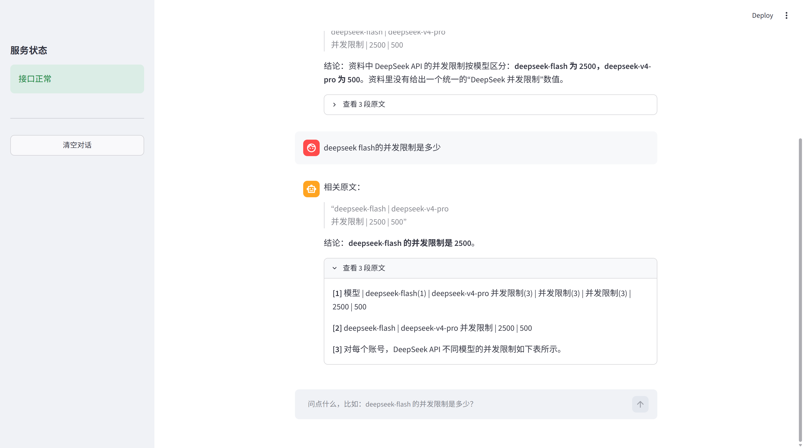

# DeepSeek 文档问答 RAG + Agent

基于 DeepSeek API 的检索增强问答系统：把技术文档放进去，提问，得到**带原文引用**的答案；再往上加一层 Agent，让它**自己决定**该查文档、该读文件，还是直接回答。

**RAG 评测：9 道题 — BM25 9/9，向量 8/9，混合检索（RRF）9/9**
**Agent 评测：3 道题 — 工具选择全部正确（闲聊不调工具、问价格调检索、问目录调文件）**



---

## 快速开始

```bash
git clone https://github.com/lingfengmaster/deepseek-rag-demo.git
cd deepseek-rag-demo
pip install -r requirements.txt
```

创建 `.env` 并填入你的 API key：

```bash
echo "DEEPSEEK_API_KEY=sk-你的key" > .env
```

**跑 RAG（命令行）**

```bash
python rag.py
```

**跑 Agent（命令行）**

```bash
python agent.py
```

**跑网页版**

```bash
# 终端 1：后端
uvicorn api:app --port 8000

# 终端 2：前端
streamlit run app.py
```

浏览器打开 `http://localhost:8501`。

---

## 两个能力

### 1. RAG 问答

把 `data/` 里的 Markdown 切分、建索引，用三种检索方式召回最相关的片段，交给模型生成带引用的答案。

### 2. Agent：自己决定用什么工具

同一个问题，模型先判断该不该动手：

| 用户问 | 模型的决定 |
|---|---|
| 你好，你能做什么 | **不调工具**，直接回答 |
| v4-pro 每百万 tokens 输出多少钱 | 调 `search_docs` 查文档 |
| data 目录下有几个文件 | 调 `list_files` 看目录 |

**这个判断是模型做的，不是代码里的 if-else。**

---

## 核心设计

### 1. RAG：表格必须按行切

朴素的按空行切分会把整张 22 行的价格表压成一个 4000 字的片段。BM25 有长度归一化惩罚，长文档得分反而更低，导致**答案明明在资料里却检索不到**。

解法：表格按行切成独立片段，每行拼上去重后的表头，并去掉对齐用的多余空格。改完之后片段从 55 个变成 84 个，最大的那块从 4000 字降到约 70 字。

### 2. 三种检索并存，用数据说话

| 检索方式 | 得分 | 特点 |
|---|---|---|
| BM25 | 9/9 | 强在精确匹配（型号、数字、条款） |
| 向量（bge-small-zh-v1.5） | 8/9 | 强在同义表达，但在**多行高度相似的表格**上会随机召回 |
| RRF 混合 | 9/9 | 本语料无额外收益，说明术语规范时 BM25 已足够 |

### 3. Agent：15 行的循环，不用框架

```python
while step < max_steps:
    msg = chat_raw(messages, tools=TOOLS)      # 模型决定
    if not msg.tool_calls:                     # 说完了就结束
        break
    for call in msg.tool_calls:                # 要动手
        result = TOOL_MAP[call.name](**args)   # 你去执行
        messages.append({"role": "tool", ...}) # 结果回填
```

**关键认知**：模型从不执行任何东西，它只输出一段"我想调用某个工具"的 JSON，真正干活的是本地 Python。所有 Agent 框架（LangChain / AutoGen / CrewAI）的内核都是这个循环。

### 4. Agent 调优：90% 是在调工具描述

`search_docs` 的描述里写了边界：

```
涉及 DeepSeek 模型名称、价格、并发限制、错误码时用它。
闲聊、自我介绍、通用知识不需要用它。
```

不写第二句，模型会把"你好"也拿去查一遍。

### 5. 工程分层：三层的职责边界

| 文件 | 只负责 | 不负责 |
|---|---|---|
| `llm.py` | 可靠地调用一次模型（重试 / 超时 / token 统计） | 业务逻辑 |
| `rag.py` | 检索与生成 | 网络、接口 |
| `agent.py` | 循环与决策 | 具体工具实现 |

重试策略在 `_is_retryable()` 一处实现：**5xx 重试，4xx 立刻失败**。曾因为绕过这层封装，Agent 遇到一次 503 就整个崩掉——这就是"防护必须集中在一处"的实证。

---

## 实验结果

完整迭代记录见 [`experiment.md`](experiment.md)。

| 版本 | 改动 | 结果 |
|---|---|---|
| v1 | 按空行切分 + BM25 | 2/4 |
| v2 | 表格按行切 + 表头拼接 | 6/6 |
| v3 | Prompt 加「先摘录后结论」 | 消除自相矛盾（输出 token 3073 → 687） |
| v4–v6 | 加语义题 + 向量 + RRF 对比 | 9/9 / 8/9 / 9/9 |
| v7 | Agent：3 个工具 + 手写循环 | 工具选择 3/3 |
| v8 | 重试下沉到 `llm.py` | Agent 具备 5xx 自动重试 |

---

## 技术栈

Python · BM25 (rank_bm25) · jieba · sentence-transformers (bge-small-zh-v1.5) · DeepSeek API · FastAPI · Streamlit · NumPy

---

## 目录结构

```
rag.py           检索 + 生成
agent.py         Agent 循环 + 工具定义
llm.py           模型调用封装（重试 / 超时 / token 统计）
api.py           FastAPI 接口
app.py           Streamlit 界面
check_retry.py   验证重试逻辑
data/            语料（5 篇 DeepSeek 官方文档）
docs/            截图
experiment.md    实验记录
```

---

## 后续计划

- [ ] 工具参数校验与路径白名单（防越权读取）
- [ ] Docker 一键部署
- [ ] 表格转文本（table-to-text）预处理
- [ ] 支持 PDF / Word 入库
- [ ] 接入 MCP
